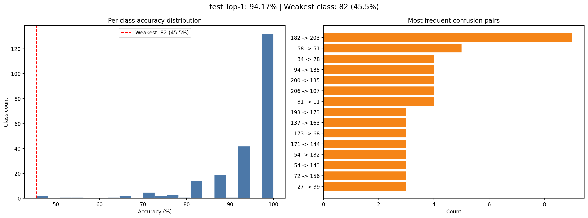

# 226-class ensemble

Classifies one isolated Turkish Sign Language sign from a clip of 32 RGB
frames. RTMW whole-body pose estimation gives 75 landmarks per frame, four
recurrent models read joint, bone, motion, geometry and hand features, and
their class probabilities are averaged with the weights 0.10 / 0.21 / 0.55 /
0.14. SignTurk uses it in the 226 mode of the live page.

## Reported evaluation

| Split | Samples | Top-1 | Top-3 | Top-5 | Macro-F1 |
| --- | ---: | ---: | ---: | ---: | ---: |
| AUTSL test (official, signer-independent) | 3,742 | 94.17% | 98.88% | 99.49% | 0.940 |

The stream weights were chosen on the validation split and fixed before the
test run. [`evaluation/`](evaluation/) keeps the summary of that evaluation:

The weakest class is `hasta` (AUTSL 82) at 45.5%. The most frequent confusion
is `siz` read as `uzgun` (9 times), followed by `eczane` read as `devlet` (5).
[`four_stream_top_confusions.csv`](evaluation/four_stream_top_confusions.csv)
lists the top pairs.

## Input pipeline

1. 32 frames evenly spaced over the clip; a shorter clip repeats its last frame.
2. YOLOX-m finds the person and RTMW (rtmw-dw-x-l, 384×288) returns the 133
   COCO-WholeBody keypoints.
3. The 17 body points are placed in MediaPipe's 33 pose slots, followed by 21
   points for each hand: 75 × (x, y, 0, score), normalised to the image size.
   Points scoring below 0.05 stay zero. Left and right are the signer's own.
4. Coordinates are centred between the shoulders and divided by the shoulder
   width. Per frame the streams get the joints (300 values), bones (144),
   their frame-to-frame motion, 39 geometry values (wrist offsets, hand speed
   and distance, visibility masks, finger angles) and the 168 hand values.

The code is in [`signturk_runtime/`](../../signturk_runtime/), the stream list
and weights in [`config.json`](config.json), the vocabulary in
[`labels/`](labels/).

## Use in SignTurk

The browser records one sign as 32 unmirrored frames. The server runs RTMW on
each frame as it arrives and the ensemble once the clip is complete. The top
sign is offered for approval when its probability is at least 0.70 and at
least 0.12 above the second.

## Scope

- Isolated signs, one at a time.
- The figures above are offline results on AUTSL.
- RTMW is the heaviest step; a GPU keeps the live mode responsive.

## Files

`python tools/download_models.py --bundle 226` downloads the four Keras
streams and the two ONNX models (about 660 MB) from the
[`model-assets-v1`](https://github.com/unsalemregulener/SignTurk/releases/tag/model-assets-v1)
release and checks their SHA-256. YOLOX and RTMW are Apache-2.0 models from
Megvii and OpenMMLab; the copies used here come from Hugging Face mirrors
listed in `model-assets.json`.
